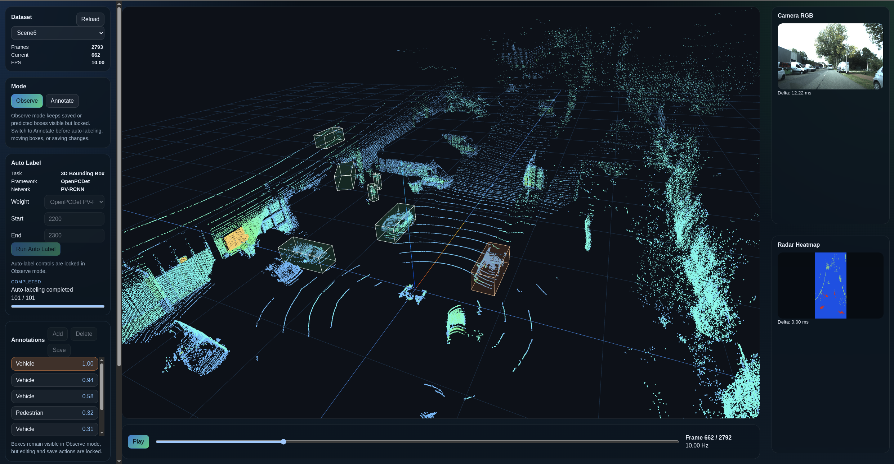

# Radar Annotation Toolkit



面向多传感器数据的 3D 标注工具原型。当前主链路是：

- Web 前端浏览和编辑 3D 框
- API 统一调度数据集、标注和任务
- OpenPCDet worker 提供 3D 检测
- API 本地执行 tracking

## 当前结构

```text
apps/web                      React 前端
services/api                  FastAPI 后端
services/workers/base         Worker Base（当前承载 OpenPCDet）
storage                       正式标注结果与运行状态
docs/images                   README 图片资源
```

## 数据集接入方式

项目已经移除了 `config/datasets/*.yaml` 这条 preset 流。

现在数据集定义全部走代码内置发现：

- 每个数据集对应一个 Python 模块
- 模块放在 `services/api/app/adapters/`
- 模块需要提供：
  - `DATASET_DEFINITION`
  - `list_dataset_scenes()`
  - `build_dataset_config(scene_id)`
  - 对应的 `DatasetAdapter` 实现

当前内置数据集：

- `radelft`
- `coloradarplus`

以后接入新数据集时，只需要新增一个 adapter Python 文件，不需要再写 YAML。

## 快速启动

### 1. 环境要求

- Docker / Docker Compose
- NVIDIA GPU 与 Docker GPU Runtime
- 已准备好多模态数据集

### 2. 配置数据挂载

当前 `docker-compose.yml` 通过环境变量 `RADELFT_DATASET_ROOT` 挂载 RaDelft 数据集。

示例：

```dotenv
RADELFT_DATASET_ROOT=D:/Datasets/RaDelft
```

可在仓库根目录创建 `.env`：

```dotenv
RADELFT_DATASET_ROOT=D:/Datasets/RaDelft
```

### 3. 启动服务

```bash
docker compose up --build
```

启动后访问：

- Web UI: [http://localhost:3300](http://localhost:3300)
- API: [http://localhost:8000](http://localhost:8000)
- Worker Base: [http://localhost:8010](http://localhost:8010)

## 默认运行方式

当前默认 compose 会：

- 自动加载内置 `radelft / Scene6`
- 启动前端、API、OpenPCDet worker
- 从 worker 目录读取模型代码和权重

当前 worker 使用的主要目录：

- 源码目录：`services/workers/base/openpcdet`
- 权重目录：`services/workers/base/openpcdet/assets`

## 已实现能力

- 多传感器联合浏览
- LiDAR 3D 可视化
- 3D 框新建、删除、编辑
- OpenPCDet 自动标注任务
- API 侧 tracking
- 标注保存与重新加载

## 当前阶段

这个仓库当前更偏“可持续迭代的工程原型”，而不是完全产品化的平台。

接下来更适合继续推进的方向：

1. 统一 worker 运行环境
2. 扩展更多检测模型
3. 继续收敛前后端遗留代码
4. 完善 annotation / tracking 工作流
