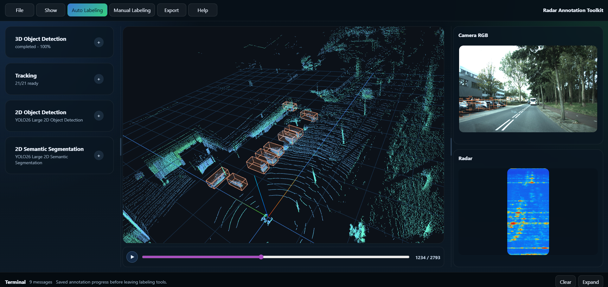

# <div align="center">**Radar Annotation Toolkit**</div>

<p align="center">
    <a href="https://wangzhaoze.github.io/">Zhaoze Wang</a>
</p>

  
<div align=center>
    
    
    
    
    
</div>

</bn>
Radar Annotation Toolkit is a web-based annotation and automation workspace for multi-sensor perception data. It currently focuses on LiDAR-centric 3D bounding box annotation, model-assisted 3D object detection, and worker-side tracking.


## GUI Overview



## 1. Build And Launch

### 1.1 Requirements

- Docker and Docker Compose
- NVIDIA GPU with Docker GPU runtime
- Prepared dataset folders mounted from the host machine
- Optional HTTP/HTTPS proxy environment variables if Docker builds need network access


### 1.2 Build Images

```bash
docker compose build
```

To rebuild only one service:

```bash
docker compose build api
docker compose build web
docker compose build worker-base
```

### 1.3 Start Services

```bash
docker compose up -d
```

If your checkpoints live somewhere else, override `WORKER_CKPT_ROOT` in your shell environment before running `docker compose up -d`.

Open the toolkit:

- Web UI: http://localhost:3300
- API: http://localhost:8000
- Worker Base: http://localhost:8010

Useful development commands:

```bash
docker compose ps
docker compose logs --tail=120 api
docker compose logs --tail=120 worker-base
docker compose restart api
docker compose restart worker-base
```

## 2. TODO

- Implement and improve tracking workflows.
- Export annotations to fixed, documented formats.
- Refactor OpenPCDet weight and config profile options.
- Deploy camera tasks based on YOLO.
- Add camera semantic segmentation.
- Add camera object detection.
- Add camera object tracking.
- Add camera depth estimation.

## 3. System Components

### 3.1 Web

The Web service is the browser-facing annotation interface under `apps/web`.

It is responsible for:

- Dataset and scene selection
- LiDAR point cloud visualization
- Camera and radar preview panels
- Manual 3D bounding box editing
- Auto-label task controls
- Tracking task controls
- Annotation filtering, layer switching, and interactive review

The Web service talks only to the API. It does not access datasets, model weights, or worker internals directly.

### 3.2 API

The API service is the orchestration backend under `services/api`.

It is responsible for:

- Dataset adapters and scene timelines
- Frame asset endpoints for LiDAR, camera, radar, and semantic layers
- Annotation storage and reload
- Job lifecycle management
- Progress updates and WebSocket status messages
- Dispatching model and tracking work to `worker-base`

Dataset definitions are code-based. New datasets are added as plugins under `services/datasets/<dataset_id>`; YAML dataset presets are no longer used.

### 3.3 Worker-Base

The Worker Base service is the shared algorithm runtime under `services/workers/base`.

It is responsible for:

- OpenPCDet 3D object detection
- YOLO image inference foundations
- Worker-side tracking algorithms
- GPU-dependent model execution
- Algorithm provider registration behind one worker container

Current provider layout:

```text
services/workers/base/worker_base   Shared worker HTTP entrypoint
services/workers/base/openpcdet     OpenPCDet provider and model profiles
services/workers/base/yolo          YOLO provider foundation
services/workers/base/tracking      Tracking provider
services/datasets                   Dataset loaders and dataset-specific model configs
```

The API sends requests to `worker-base` through `WORKER_URL`. The worker returns serialized model or tracking results, and the API decides how to write them back into the active annotation set.